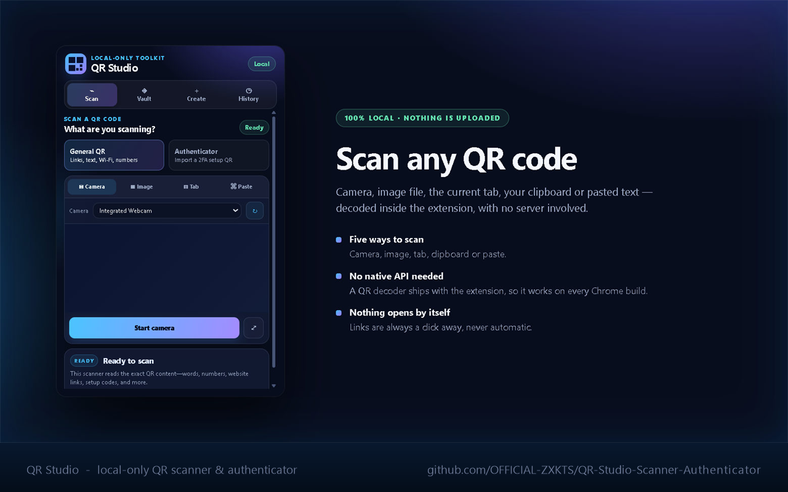
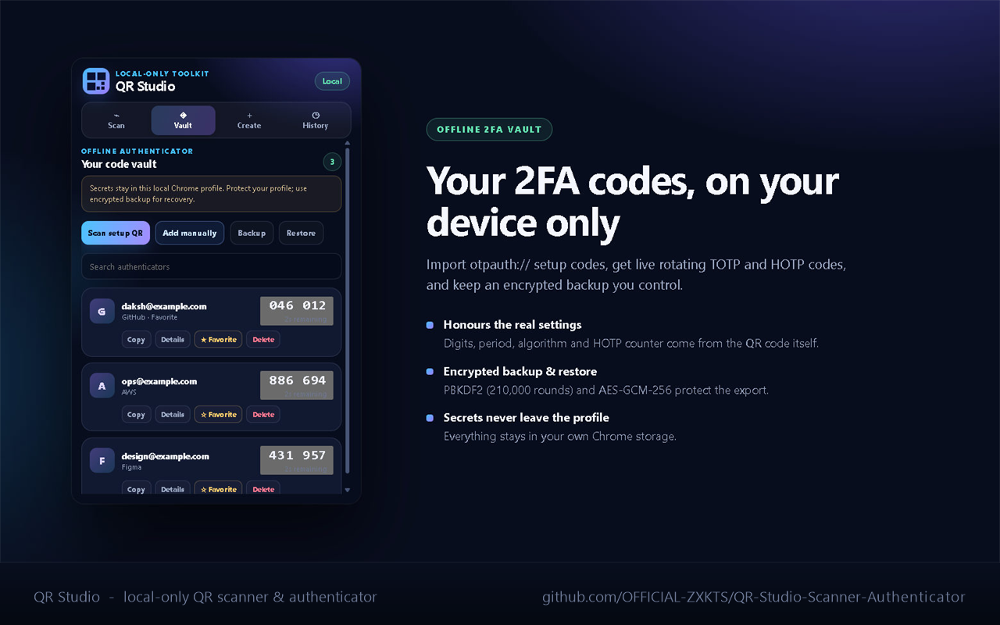
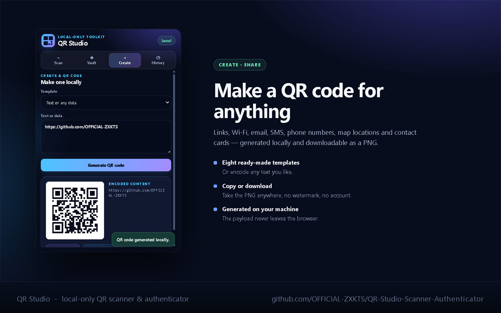
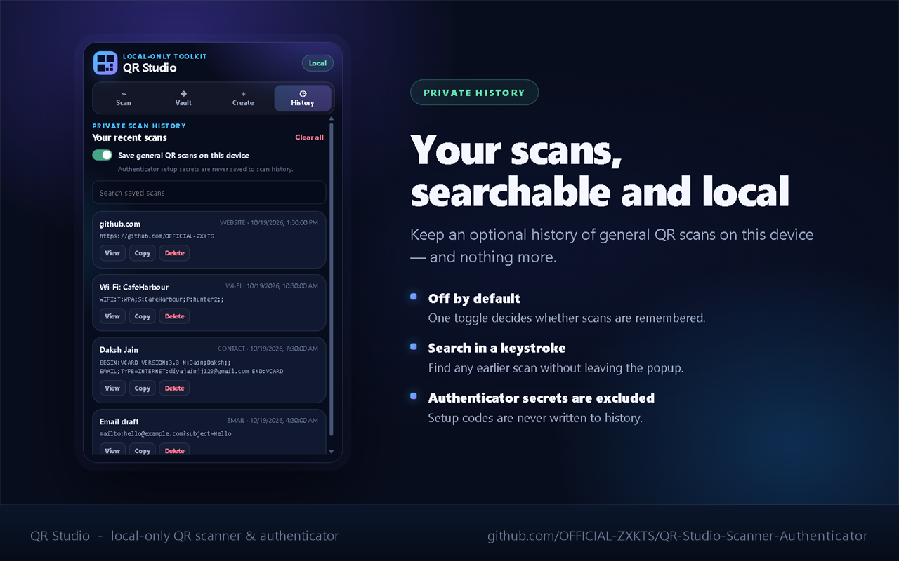

<p align="center">
  
</p>

<h1 align="center">QR Studio — Scanner &amp; Authenticator</h1>

<p align="center">
  A local-only Chrome extension that scans and creates QR codes and keeps an offline 2FA vault.
  <br>
  <b>No network calls. No analytics. No accounts. No cloud.</b>
</p>

<p align="center">
  <a href="#install">Install</a> •
  <a href="#features">Features</a> •
  <a href="#privacy--security">Privacy</a> •
  <a href="#development">Development</a> •
  <a href="#contributing">Contributing</a>
</p>

---

## Why QR Studio?

Most QR tools send your scan to a server to decode it. A QR code can contain a
password reset link, a Wi-Fi passphrase, or a 2FA seed — and those should never
travel across the internet to be read.

QR Studio does everything **inside the browser extension**: decoding, creation,
OTP generation, and encrypted backups. It makes zero network requests.

| | QR Studio | Typical online QR tool |
|---|---|---|
| QR data leaves your device | **Never** | Usually sent to a server |
| Analytics / tracking | **None** | Common |
| Works offline | **Yes** | No |
| Offline 2FA vault | **Yes** | No |
| Encrypted export | **Yes** (PBKDF2 + AES-GCM) | No |

---

## Features

### 🔍 Scan

Decode a QR code from five sources:

- **Camera** — live scanning with an in-page scanner, or a dedicated full-screen
  camera tab for phones and awkward angles.
- **Image** — pick any image file from your computer.
- **Tab** — capture and decode the QR code in the current browser tab.
- **Paste** — paste raw QR contents (or an `otpauth://` setup URI) as text.
- **Clipboard** — paste an image with `Ctrl`/`Cmd` + `V`, or drop an image onto
  the scanner.

The decoder is bundled locally, so scanning works on Chrome builds that lack
the native `BarcodeDetector` API.

### 🗝️ Vault — offline authenticator

- Import standard `otpauth://` **TOTP** and **HOTP** setup codes by scanning
  the setup QR, or add them by hand.
- The vault honours the **digit count, time period, algorithm and HOTP counter
  declared by the QR payload** — it does not assume "6 digits, 30 seconds,
  SHA-1".
- Live rotating codes with a countdown, favourites, and search.
- **Backup** and **Restore** with a password-encrypted file
  (`qr-studio-encrypted-v1`: PBKDF2-SHA-256, 210,000 iterations → AES-GCM-256).
  QR Studio never stores the backup password.

### 🎨 Create

Generate a QR code locally for:

- arbitrary text or data
- website links
- Wi-Fi networks
- email messages
- SMS messages
- phone numbers
- map locations
- contact cards

Copy the encoded payload or download the result as a PNG.

### 🕘 History

- Optional local history of **general** QR scans, off by default, with search.
- **Authenticator setup secrets are never written to history.**

---

## Screenshots

| Scan | Vault |
|---|---|
|  |  |

| Create | History |
|---|---|
|  |  |

---

## Install

### Load it locally (development)

1. Open `chrome://extensions`
2. Enable **Developer mode** (top right)
3. Click **Load unpacked** and select this repository folder
4. Pin **QR Studio** from Chrome's Extensions menu

### Chrome Web Store

The store listing is in progress — see
[`docs/CHROME_WEB_STORE.md`](docs/CHROME_WEB_STORE.md) for the submission
checklist and the ready-to-paste listing copy.

---

## How QR content is handled

**General QR codes** always preserve the exact decoded payload. It can be a
word, a number, a URL, a contact card, a Wi-Fi string or any other text. URLs
are **never opened automatically** — the extension always shows an explicit
button, so a malicious QR code cannot navigate you anywhere on its own.

**Authenticator QR codes** are handled differently on purpose, because they
contain a long-term secret:

- the secret is **redacted** from the result,
- it is **never copied** to the clipboard automatically,
- it is **never added** to scan history,
- you must review it and explicitly choose to save it into the vault.

---

## Privacy & security

**QR Studio never makes a network request.** There is no analytics, no
telemetry, no remote configuration, no update pings and no third-party
service — the extension works with your machine fully offline.

| Data | Where it lives | When |
|---|---|---|
| General scan history | `chrome.storage.local` | Only if you turn history on (off by default) |
| Vault accounts & OTP secrets | `chrome.storage.local` | When you save an account |
| Backup files | Wherever you save them | When you export a backup |

Authenticator secrets live in the **unencrypted** `chrome.storage.local` of
your Chrome profile. That is convenient, but it is *not* the same as a
hardware-backed phone authenticator or a dedicated password manager. Protect
your Chrome profile, use a strong OS account password with full-disk
encryption, and export an encrypted backup.

Full details: [`docs/PRIVACY.md`](docs/PRIVACY.md).

### Permissions

| Permission | Why it is needed |
|---|---|
| `storage` | Keeps your vault accounts, settings and (opt-in) history in your local Chrome profile. |
| `activeTab` | Used **only on demand**: to capture the visible tab when you click *Tab* to scan a QR code on the page, and to open a result link or the full-screen camera in a new tab. It is never used to read page content in the background. |

The extension requests **no host permissions** and has **no content scripts**,
so it cannot read or modify any web page on its own.

---

## Development

### Project structure

```
Extension/
├── manifest.json          # MV3 manifest
├── popup.html             # UI markup
├── popup.css              # UI styles (responsive, no framework)
├── popup.js               # all extension logic
├── icons/                 # extension icon set (16/32/48/128/512)
├── jsqr.js                # vendored: jsQR 1.4.0 (Apache-2.0)
├── qrcode-generator.js    # vendored: qrcode-generator 1.4.4 (MIT)
├── assets/                # logo used by the README
├── docs/                  # privacy policy + store submission guide
├── scripts/               # packaging helpers
├── store/                 # Chrome Web Store assets + listing copy
└── .github/               # CI workflow and issue templates
```

There is no build step and no dependency install — the extension is plain
HTML/CSS/JS and is loaded straight from this folder.

### Build a store-ready zip

```bash
# Windows (PowerShell)
./scripts/package-extension.ps1

# macOS / Linux
./scripts/package-extension.sh
```

Both scripts produce `dist/qr-studio-<version>.zip` containing **only** the
files Chrome should load (manifest, popup, vendored libraries and icons), and
they verify the manifest parses before zipping.

### Continuous integration

`.github/workflows/build-extension.yml` runs on every push and pull request. It
validates `manifest.json`, checks that every file referenced by the manifest
exists, confirms the local-only promise still holds (no host permissions, no
content scripts, no remote CSP sources), verifies the vendored libraries still
carry their licence headers, round-trips a QR code through both vendored
libraries, and builds the distributable zip as a downloadable artifact.

### Run the library check locally

```bash
node scripts/verify-libraries.js
```

It encodes a string with the bundled `qrcode-generator`, rasterises the matrix
and decodes it again with the bundled `jsQR` build, so a broken or truncated
vendor file fails fast instead of silently breaking scanning.

### Requirements for local testing

- Chrome 88+ (Manifest V3). The tab-capture source needs a recent build.
- `chrome://extensions` → **Developer mode** → **Load unpacked**.

---

## Contributing

Issues and pull requests are welcome — see
[`CONTRIBUTING.md`](CONTRIBUTING.md) for the workflow, and
[`CODE_OF_CONDUCT.md`](CODE_OF_CONDUCT.md) for the ground rules.

Found a security issue instead? Please follow
[`SECURITY.md`](SECURITY.md) — do not open a public issue.

---

## License

Released under the [MIT License](LICENSE) © 2026 Daksh Jain.

## Acknowledgements

This project bundles two local browser-side libraries so that QR scanning and
creation work without uploading anything to a remote service:

- **jsQR 1.4.0** — Apache License 2.0 — <https://github.com/cozmo/jsQR>
- **QR Code generator for JavaScript 1.4.4** — MIT License —
  <https://github.com/kazuhikoarase/qrcode-generator>

See [`THIRD_PARTY_NOTICES.md`](THIRD_PARTY_NOTICES.md) for attribution details.
