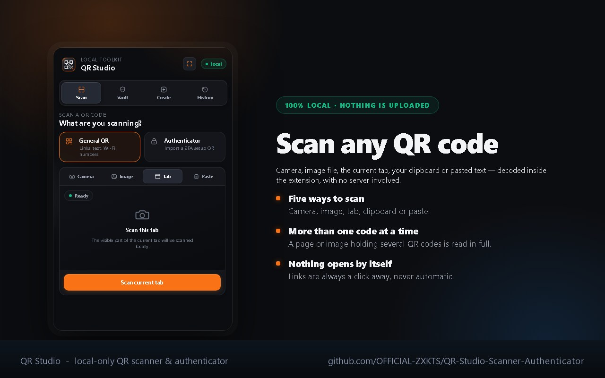
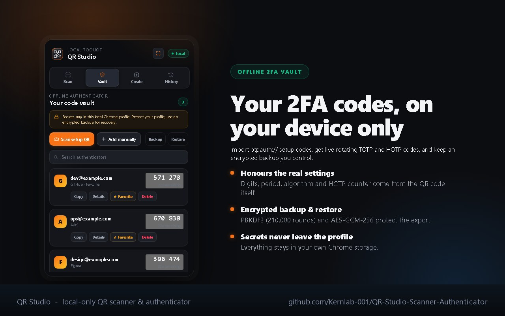
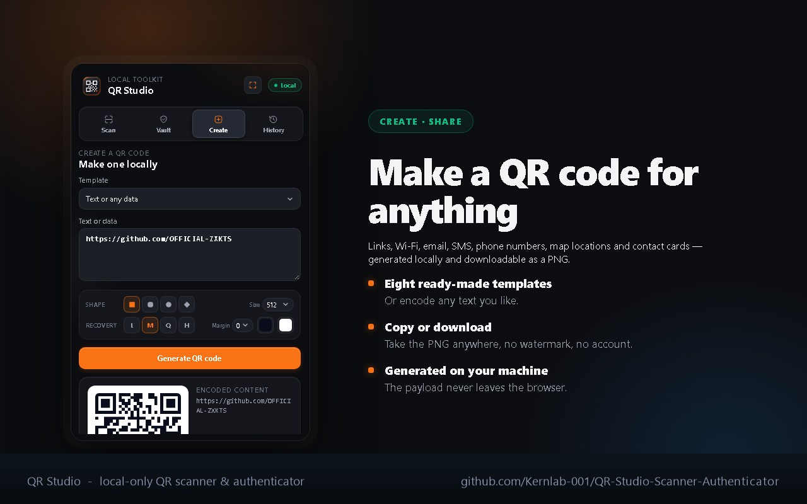
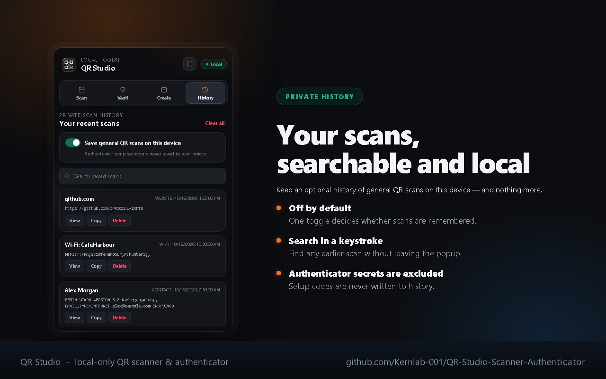

<p align="center">
  
</p>

<h1 align="center">QR Studio — Scanner &amp; Authenticator</h1>

<p align="center">
  A local-only Chrome extension that scans and creates QR codes and keeps an offline 2FA vault.
  <br>
  <b>No analytics. No tracking. Your QR data never leaves your device.</b>
</p>

<p align="center">
  <a href="#install">Install</a> •
  <a href="#features">Features</a> •
  <a href="#privacy--security">Privacy</a> •
  <a href="#development">Development</a> •
  <a href="#contributing">Contributing</a>
</p>

---

## Why QR Studio?

Most QR tools send your scan to a server to decode it. A QR code can contain a
password reset link, a Wi-Fi passphrase, or a 2FA seed — and those should never
travel across the internet to be read.

QR Studio does everything **inside the browser extension**: decoding, creation,
OTP generation, and encrypted backups. The only time it talks to anything is
when you choose to sign in to your own account.

| | QR Studio | Typical online QR tool |
|---|---|---|
| QR data leaves your device | **Never** | Usually sent to a server |
| Analytics / tracking | **None** | Common |
| Works offline | **Yes** | No |
| Offline 2FA vault | **Yes** | No |
| Encrypted export | **Yes** (PBKDF2 + AES-GCM) | No |

---

## Features

### 🔍 Scan

Decode a QR code from five sources:

- **Camera** — live scanning with an in-page scanner, or a dedicated standalone
  tab for phones and awkward angles.
- **Image** — pick any image file from your computer.
- **Tab** — capture and decode the QR code in the current browser tab.
- **Paste** — paste raw QR contents (or an `otpauth://` setup URI) as text.
- **Clipboard** — paste an image with `Ctrl`/`Cmd` + `V`, or drop an image onto
  the scanner.
- **Several codes at once** — when a page, tab or image holds more than one QR
  code, all of them are recognised. The first one opens as the result and the
  others are listed underneath, each with its own copy and open action.

The decoder is bundled locally, so scanning works on Chrome builds that lack
the native `BarcodeDetector` API.

Press the expand button in the header to open QR Studio in its own tab. All four
sections — Scan, Vault, Create and History — then use the roomy, centred
layout instead of the compact popup.

### 🗝️ Vault — offline authenticator

- Import standard `otpauth://` **TOTP** and **HOTP** setup codes by scanning
  the setup QR, or add them by hand.
- The vault honours the **digit count, time period, algorithm and HOTP counter
  declared by the QR payload** — it does not assume "6 digits, 30 seconds,
  SHA-1".
- Live rotating codes with a countdown, favourites, and search.
- **Backup** and **Restore** with a password-encrypted file
  (`qr-studio-encrypted-v1`: PBKDF2-SHA-256, 210,000 iterations → AES-GCM-256).
  QR Studio never stores the backup password.

### 🎨 Create

Generate a QR code locally for:

- arbitrary text or data
- website links
- Wi-Fi networks
- email messages
- SMS messages
- phone numbers
- map locations
- contact cards

Copy the encoded payload or download the result as a PNG or SVG.

The style controls set the **module shape** (square, rounded, circle, diamond),
the **error-correction level** (L/M/Q/H), the **quiet zone**, the **output size**
and the **foreground and background colours**. If the chosen colours are too
close for a scanner to read, a warning appears before you export. The finder,
timing and alignment patterns always stay square, so a styled code still scans.

### 🕘 History

- Optional local history of **general** QR scans, off by default, with search.
- **Authenticator setup secrets are never written to history.**

---

## Screenshots

| Scan | Vault |
|---|---|
|  |  |

| Create | History |
|---|---|
|  |  |

---

## Install

QR Studio is currently **in development and not yet published to the Chrome Web
Store**. To run it now, load it from source:

1. Open `chrome://extensions`
2. Enable **Developer mode** (top right)
3. Click **Load unpacked** and select this repository folder
4. Pin **QR Studio** from Chrome's Extensions menu

The store listing is being prepared separately; this repository is the
**source code**, not a download channel.

---

## How QR content is handled

**General QR codes** always preserve the exact decoded payload. It can be a
word, a number, a URL, a contact card, a Wi-Fi string or any other text. URLs
are **never opened automatically** — the extension always shows an explicit
button, so a malicious QR code cannot navigate you anywhere on its own.

**Authenticator QR codes** are handled differently on purpose, because they
contain a long-term secret:

- the secret is **redacted** from the result,
- it is **never copied** to the clipboard automatically,
- it is **never added** to scan history,
- you must review it and explicitly choose to save it into the vault.

---

## Privacy & security

**Your QR data never makes a network request.** There is no analytics, no
telemetry, no remote configuration, no update pings and no third-party service
— the extension works with your machine fully offline.

The one exception is the optional account: if you choose to sign in, that is a
sign-in request to your own account server, and nothing else is ever sent. You
do not need an account for anything, and the extension never loads anything
from a server.

| Data | Where it lives | When |
|---|---|---|
| General scan history | `chrome.storage.local` | Only if you turn history on (off by default) |
| Vault accounts & OTP secrets | `chrome.storage.local` | When you save an account |
| Backup files | Wherever you save them | When you export a backup |
| Signed-in email and session token | `chrome.storage.local` | Only if you sign in |

Chrome's user-data rules require disclosure even for data that never leaves the
device, so the store listing declares exactly two categories:
**authentication information** (your vault secrets) and **user activity** (your
opt-in scan history) — both stored locally, for app functionality only, and
never transmitted.

Authenticator secrets live in the **unencrypted** `chrome.storage.local` of
your Chrome profile. That is convenient, but it is *not* the same as a
hardware-backed phone authenticator or a dedicated password manager. Protect
your Chrome profile, use a strong OS account password with full-disk
encryption, and export an encrypted backup.

Full details: [`docs/PRIVACY.md`](docs/PRIVACY.md).

### Permissions

| Permission | Why it is needed |
|---|---|
| `storage` | Keeps your vault accounts, settings and (opt-in) history in your local Chrome profile. |
| `activeTab` | Used **only on demand**: to capture the visible tab when you click *Tab* to scan a QR code on the page, and to open a result link or the full-screen camera in a new tab. It is never used to read page content in the background. |

The extension requests **no host permissions** and has **no content scripts**,
so it cannot read or modify any web page on its own.

---

## Development

### Project structure

```
Extension/
├── manifest.json          # MV3 manifest
├── popup.html             # UI markup
├── popup.css              # UI styles (responsive, no framework)
├── popup.js               # all extension logic
├── icons/                 # extension icon set (16/32/48/128/512)
├── jsqr.js                # vendored: jsQR 1.4.0 (Apache-2.0)
├── qrcode-generator.js    # vendored: qrcode-generator 1.4.4 (MIT)
├── assets/                # logo used by the README
├── docs/                  # privacy policy (Markdown + standalone page) + gallery
├── scripts/               # packaging helpers and the library smoke test
└── .github/               # CI workflow and issue templates
```

There is no build step and no dependency install — the extension is plain
HTML/CSS/JS and is loaded straight from this folder.

### Build a store-ready zip

```bash
# Windows (PowerShell)
./scripts/package-extension.ps1

# macOS / Linux
./scripts/package-extension.sh
```

Both scripts produce `dist/qr-studio-<version>.zip` containing **only** the
files Chrome should load (manifest, popup, vendored libraries and icons), and
they verify the manifest parses before zipping.

### Continuous integration

`.github/workflows/build-extension.yml` runs on every push and pull request. It
validates `manifest.json`, checks that every file referenced by the manifest
exists, confirms the local-only promise still holds (no host permissions, no
content scripts, no remote CSP sources), verifies the vendored libraries still
carry their licence headers, round-trips a QR code through both vendored
libraries, and builds the distributable zip as a downloadable artifact.

### Run the library check locally

```bash
node scripts/verify-libraries.js
```

It encodes a string with the bundled `qrcode-generator`, rasterises the matrix
and decodes it again with the bundled `jsQR` build, so a broken or truncated
vendor file fails fast instead of silently breaking scanning.

### Run the tests

```bash
node --test tests/
```

The tests load the extension's own code outside the browser, so the real
functions are the ones being checked. They cover:

- the importers, against the formats the apps really write — a Google
  Authenticator export in the format Google uses, a 2FAS backup, and a list of
  setup links;
- every code the extension makes, read back with the decoder that ships with
  it, in plain ASCII and in Hindi, Chinese, Cyrillic, emoji and accented text;
- signing out, and the pages not having two things with the same name.

### Requirements for local testing

- Chrome 88+ (Manifest V3). The tab-capture source needs a recent build.
- `chrome://extensions` → **Developer mode** → **Load unpacked**.

### Account server setup

The account system is optional, but if you point the extension at an account
server of your own there is one setting that is easy to miss.

Under **Authentication → URL Configuration → Redirect URLs** on the account
server, add Chrome's redirect address for this extension:

```
https://<extension id>.chromiumapp.org/
```

Get the exact address by opening the account page in the extension and running
`chrome.identity.getRedirectURL()` in the console, or by copying it from
`account-config.js`. It always ends in `.chromiumapp.org/` and the id in the
middle must match the extension's id exactly.

Without that entry the account server sends the sign-in to its own site
address instead of back to the extension, the sign-in never completes, and the
account page reports that the authorization page could not be loaded.

Set the account server's **Site URL** to a real page as well. It is where the
account server sends the browser when something goes wrong, and the default
`http://localhost:3000` is not a page anyone can see.

### Granting Pro to an account

An account can include QR Studio Pro. The entitlement is written into the
account's own details on the account server, which are part of the signed-in
session, so the extension finds out without asking the server anything extra.

```bash
export SUPABASE_SERVICE_KEY='your-service-role-key'
node tools/grant-pro.mjs --email someone@example.com --months 12
node tools/grant-pro.mjs --email someone@example.com --forever
node tools/grant-pro.mjs --email someone@example.com --revoke
```

The service role key is the secret key from the account server dashboard, under
**Project Settings → API → service_role**. The tool reads it from the
environment so it never lands in the repository.

The person has to **sign out and sign in again** afterwards, because the
entitlement is part of the session they sign in with.

A licence key still works on its own, without an account. The two are
alternatives: either one unlocks Pro.

### Licence terms

There are two kinds of licence, and both carry their own end date.

**A Pro licence** is what a buyer ends up with. It is issued for a month or a
year, and it is checked on the device with the public key alone:

```bash
node tools/sign-licence.mjs --email buyer@example.com --months 1    # a month
node tools/sign-licence.mjs --email buyer@example.com --months 12   # a year
node tools/sign-licence.mjs --email buyer@example.com --forever    # never ends
```

**A claim licence** is the short-lived one a buyer is handed after paying. It
lasts fifteen minutes, every one issued is different, and it is not a Pro
licence: it has to be exchanged for a Pro entitlement on the buyer's account,
which is what actually lasts.

```bash
node tools/issue-claim-licence.mjs --email buyer@example.com
```

It can also be imported, so the same code can sit inside whatever already
handles the payment confirmation:

```js
import { issueClaimLicence } from './tools/issue-claim-licence.mjs';
const { key } = issueClaimLicence({ email });
```

**The signing key never leaves the machine that holds it.** The extension
carries the public half only, so it can check a licence but cannot make one.
Anything that issues a licence has to run where the private key is: a small
server, a webhook handler, a scheduled job.

### When a licence runs out

Both kinds end on their own, with nothing to remember to do:

- The extension checks the end date every time it looks, so a licence that
  has run out stops counting the moment it does.
- A licence that has run out is **taken out of the profile**, so it is not
  left lying in the Chrome data.
- A Pro account that has run out is not Pro any more. The end date travels
  with the session, so no request is needed to notice it.

The account server is the same way round: a Pro account carries
`qrstudio_pro_expires`, and the same end date applies there.

---

## Contributing

Issues and pull requests are welcome — see
[`CONTRIBUTING.md`](CONTRIBUTING.md) for the workflow, and
[`CODE_OF_CONDUCT.md`](CODE_OF_CONDUCT.md) for the ground rules.

Found a security issue instead? Please follow
[`SECURITY.md`](SECURITY.md) — do not open a public issue.

---

## License

Released under the [MIT License](LICENSE) © 2026 Kernlab-001.

## Acknowledgements

This project bundles two local browser-side libraries so that QR scanning and
creation work without uploading anything to a remote service:

- **jsQR 1.4.0** — Apache License 2.0 — <https://github.com/cozmo/jsQR>
- **QR Code generator for JavaScript 1.4.4** — MIT License —
  <https://github.com/kazuhikoarase/qrcode-generator>

See [`THIRD_PARTY_NOTICES.md`](THIRD_PARTY_NOTICES.md) for attribution details.
